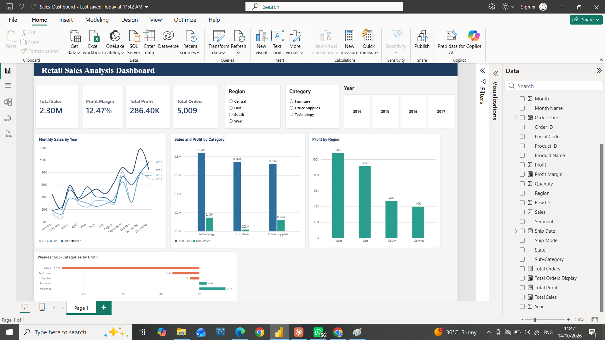

# Retail Sales Analysis (Excel, MySQL, Python, Power BI)

An end-to-end data analysis project on the Sample Superstore dataset. The goal is to understand sales performance, find profitable and loss-making products, and measure how discounts affect profit. The same results were calculated in four tools and cross-checked against each other.



## Business problem

A retail company wants to know:
- What are its total sales, profit and profit margin?
- Which categories, regions and products perform best and worst?
- Which products or orders lose money?
- How do sales change month by month?
- Does a higher discount reduce profit?

## Dataset

- **Source:** Sample Superstore (public learning dataset)
- **Size:** 9,994 order lines, 21 columns
- **Period:** January 2014 to December 2017
- **Key columns:** Order ID, Order Date, Category, Sub-Category, Region, Customer Name, Sales, Quantity, Discount, Profit

## Tools used

| Tool | Purpose |
|---|---|
| Excel | Data quality checks, summary formulas, PivotTables |
| MySQL | Loading the data and answering business questions with SQL |
| Python (Pandas, matplotlib) | Cleaning, analysis and charts in a Jupyter notebook |
| Power BI | Interactive dashboard with KPI cards, charts and slicers |

## Project structure

```
Retail-Sales-Analysis/
├── data/
│   ├── raw/                 Original CSV (never edited)
│   └── cleaned/             Cleaned CSV used by Power BI
├── excel/
│   └── Sales-Analysis.xlsx
├── sql/
│   ├── load_superstore.sql
│   └── analysis_queries.sql
├── python/
│   └── sales_analysis.ipynb
├── powerbi/
│   ├── Sales-Dashboard.pbix
│   └── dashboard.png
└── README.md
```

## Data cleaning steps

1. Read the CSV with `latin1` encoding, because the file is not UTF-8.
2. Converted Order Date and Ship Date from text (MM/DD/YYYY) to real dates.
3. Checked for missing values and duplicate rows. Both were zero.
4. Added Year, Month and Month Name columns.
5. Stored postal codes as 5-character text so leading zeros are kept.
6. Validated totals across tools (sales 2,297,200.86 and profit 286,397.02 matched in Excel, SQL, Python and Power BI).

## Key metrics

| Metric | Value |
|---|---|
| Total Sales | 2,297,200.86 |
| Total Profit | 286,397.02 |
| Total Orders | 5,009 |
| Profit Margin | 12.47% |

## Key findings

1. **Category:** Technology earns the most profit (145,455) on sales of 836,154. Furniture has high sales (741,999) but only 18,451 in profit.
2. **Loss-making sub-categories:** Tables (-17,725), Bookcases (-3,473) and Supplies (-1,189) lose money. Tables and Bookcases explain Furniture's low profit.
3. **Region:** West is the most profitable region (108,418). Central has the weakest margin at about 7.9%, even though its sales (501,240) are higher than South's.
4. **Discounts:** Lines with no discount earn a 29.5% margin and lines with 1-20% earn 11.9%. Above 20% discount the margin turns negative (-15.3% for 21-40% and -77.4% above 40%). The 1,393 lines with discounts above 20% lose about 135,376 in total.
5. **Loss-making products:** The biggest product losses are the Cubify CubeX 3D Printer (Double Head, -8,880) and the Lexmark MX611dhe laser printer (-4,590).
6. **Loss-making lines:** 1,871 order lines lose money, with a combined loss of 156,131.
7. **Seasonality and growth:** Sales peak in September, November and December every year, and February is the weakest month. Sales dipped about 3% in 2015, then grew about 29% in 2016 and about 20% in 2017.
8. **Customers:** The top customer by sales, Sean Miller (25,043), is unprofitable at -1,981.

## Recommendations

- Review or cap discounts above 20%, since they consistently produce losses.
- Review pricing on Tables, Bookcases and the loss-making printers.
- Investigate why Central's margin is much lower than the other regions.
- Plan inventory and promotions around the September to December peak.
- Check the discount pattern behind high-volume customers who are unprofitable.

## SQL highlights

The queries in `sql/analysis_queries.sql` use `GROUP BY`, `HAVING`, `CASE WHEN`, date functions and `COUNT(DISTINCT ...)` to calculate KPIs, loss-making sub-categories, monthly trends, discount bands and top customers.

## How to run

1. **SQL:** Run `sql/load_superstore.sql` in MySQL Workbench (Server → Data Import), then run `sql/analysis_queries.sql`.
2. **Python:** Install `pandas`, `matplotlib` and `jupyter`, then open `python/sales_analysis.ipynb` and choose Restart & Run All. Update the file paths in the first cells to match your computer.
3. **Power BI:** Open `powerbi/Sales-Dashboard.pbix` in Power BI Desktop. If it asks for the data source, point it to `data/cleaned/cleaned_superstore.csv`.

## Author

**Mohd Anas Ansari**
B.Tech Computer Science graduate, aspiring Data Analyst

- GitHub: https://www.linkedin.com/in/mohd-anas-ansari-/
- LinkedIn: https://github.com/anas-2733
